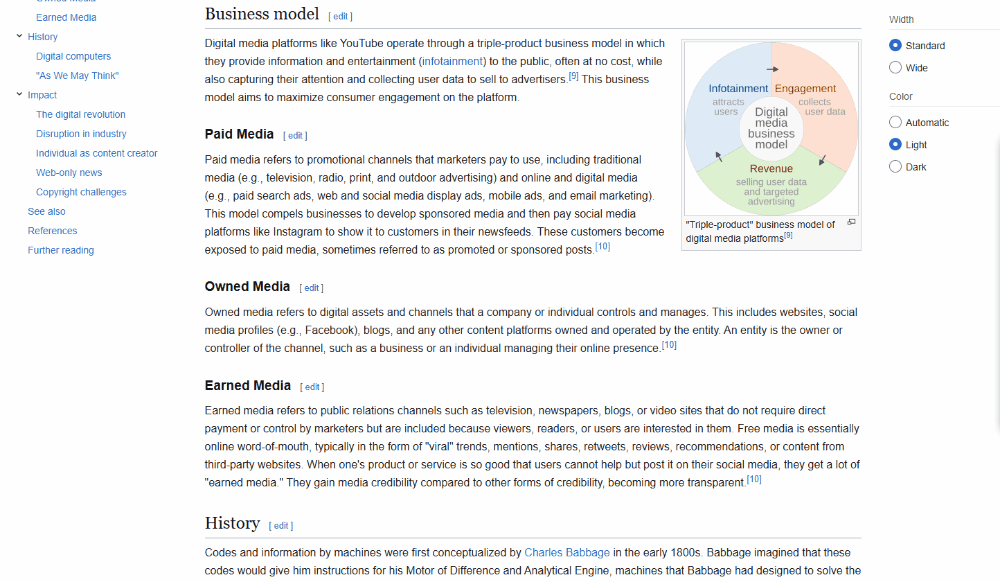

# Cursor Translate

A lightweight Windows tool that translates any text under your mouse cursor — in **any app** — just by resting the mouse over it. No selecting, no copy-pasting, no switching windows.



## Features

- **Hover to translate** in browsers, desktop apps, menus, buttons, PDFs and more.
- **Two ways to read text:**
  - **UI Automation** , asks the app itself for the text under the cursor (fast and exact).
  - **Windows OCR**, fallback for images, games and apps that don't expose their text.
- **Floating bubble** next to the cursor with the translation and the original text.
- **Ctrl mode (Active)**, only translate while holding `Ctrl`.
- **Global hotkey**, `Ctrl + Alt + T` toggles the translator on and off from anywhere.
- **System tray**, runs quietly in the tray (Open / Enabled / Exit).
- **Rate-limit friendly**, caching, request throttling, and an automatic fallback service if the main one is temporarily blocked.
- **Modern dark UI** with toggle switches.
- **Translation modes**, translate the single word, the whole sentence or the whole line under the cursor.
- **Remembers your settings** - languages and options are saved between sessions.

## Download

Get the latest version from the [Releases page](https://github.com/OdiazLz/CursorTranslate/releases/latest): download the `.zip`, extract it and run `CursorTranslate.exe`.

Requires Windows 10 (build 19041+) or Windows 11. No .NET install needed.

> Windows SmartScreen may warn you because the app isn't code-signed yet. Click **More info → Run anyway**.

## How it works

1. A timer checks the mouse position every 50 ms.
2. When the mouse rests on something, the app reads the text under it with **UI Automation**; if nothing comes back, it captures a small strip of the screen and runs **Windows OCR**, picking the line closest to the cursor.
3. The text is sent to a translation service and shown in a click-through, non-focus-stealing bubble.

## Requirements (to build from source)

- Windows 10 (version 2004 / build 19041) or Windows 11
- [.NET 8 SDK](https://dotnet.microsoft.com/download/dotnet/8.0)
- Visual Studio 2022 with the **.NET desktop development** workload (or the `dotnet` CLI)

### OCR language packs

Windows OCR only reads languages that are installed on your system. To read English text on a Windows installed in another language, run this in PowerShell **as administrator**:

```powershell
Add-WindowsCapability -Online -Name "Language.OCR~~~en-US~0.0.1.0"
```

## Build and run

```bash
git clone https://github.com/OdiazLz/CursorTranslate.git
cd CursorTranslate
dotnet run --project CursorTranslate
```

Or open `CursorTranslate.sln` in Visual Studio and press **F5**.

## Usage

| Action | How |
| Translate | Rest the mouse over any text |
| Ctrl-only mode | Turn on **Only while holding Ctrl** |
| Toggle on/off | `Ctrl + Alt + T` or the tray menu |
| Open the window | Double-click the tray icon |
| Exit | Right-click the tray icon → **Exit** |

## Translation services

1. **DeepL API** — used when you add your own API key (the DeepL API Free plan includes 500,000 characters per month).
2. **Google Translate (unofficial endpoint)** — no key needed, but it may rate-limit you (HTTP 429) with heavy use.
3. **MyMemory** — free fallback used automatically while Google is rate-limited.

### Setting up DeepL

1. Create a free account at [DeepL API](https://www.deepl.com/pro-api) and copy your API key.
2. Run Cursor Translate once, then exit it from the tray menu.
3. Open `%AppData%\CursorTranslate\settings.json` and paste your key into `"DeepLApiKey"`.
4. Start the app again. The status bar will show `→ DeepL`.


## License

This project is licensed under the **GNU General Public License v3.0** — see the [LICENSE](LICENSE) file for details.
